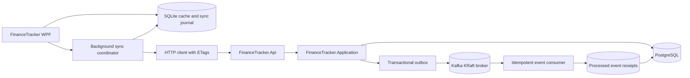

# Backend architecture

The backend is a modular monolith. The WPF client opens its local SQLite cache first, then probes the configured API in the background. When PostgreSQL is reachable, a sync coordinator reconciles transactions in both directions; when it is unavailable, the app remains usable offline and queues local changes.

## Request path

1. The API validates the request and checks account/category state and amount sign.
2. The application service writes a transaction and an outbox record together in PostgreSQL.
3. The outbox publisher sends the event to `finance.transaction-events.v1`.
4. The event consumer stores a receipt keyed by event ID, then commits the Kafka offset.

The outbox provides atomicity between the financial transaction and the intent to publish. Delivery is at least once: a crash after Kafka accepts a record but before the outbox row is marked can cause a duplicate. The unique event ID makes the consumer safe to replay. Kafka is not the source of truth and is not involved in API reads.

## Local boundaries

- Docker Compose publishes only the API on loopback. PostgreSQL and Kafka stay on the private Compose network.
- The WPF application runs on Windows, outside Docker.
- Swagger is enabled only in the API Development environment.
- API readiness checks PostgreSQL and applied migrations; Kafka availability does not make finance data unavailable.
- Demo seed records are synthetic and marked `[DEMO]`.

## Desktop synchronization

The API URL is saved in `%LOCALAPPDATA%\\FinanceTracker\\settings.json`, defaulting to `http://127.0.0.1:5080/`. Startup opens SQLite before probing `/health/ready`. If the backend is unavailable, the user can retry, continue offline, or exit. Synchronization runs in bounded background batches and locks only affected transaction rows. A stable transaction GUID links local and server records; database-local integer IDs are never treated as shared identity.

Each local record is compared with its last-synchronized snapshot and the current PostgreSQL record. A one-sided edit is copied across. Independent edits to the same record keep both versions and prompt the user to choose before applying either. Tombstones represent deletes. On online close, the app waits for sync and verifies convergence; unresolved conflicts or failures are surfaced, and pending local changes remain recoverable if the user closes.
